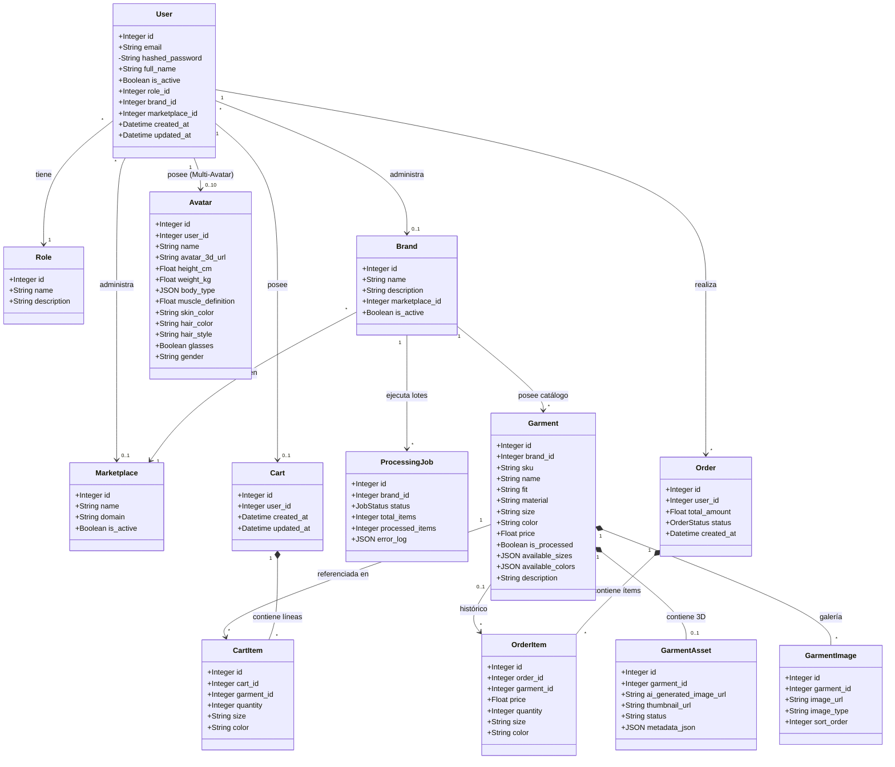
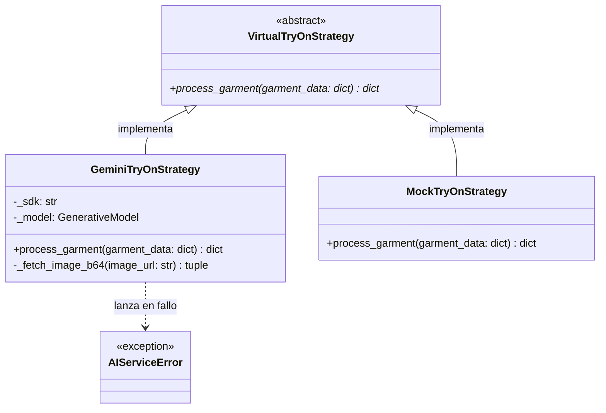
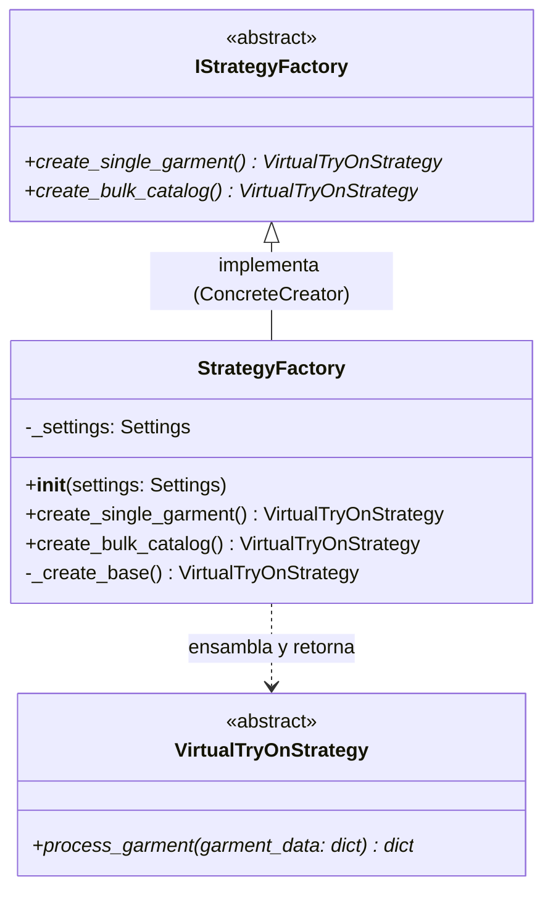
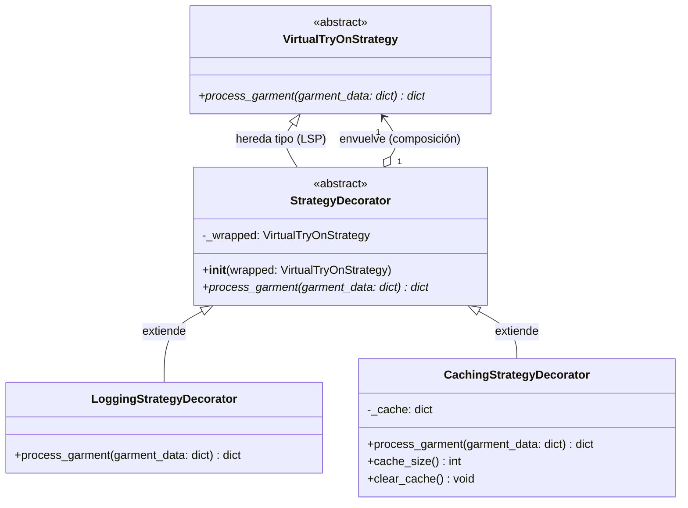
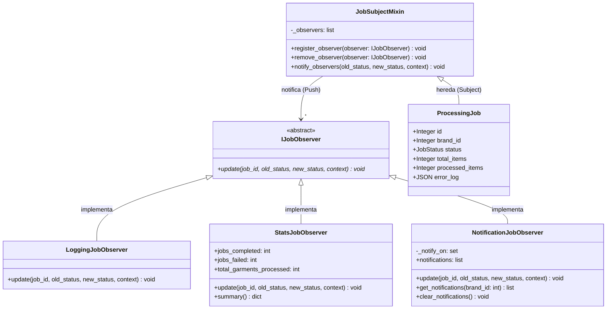
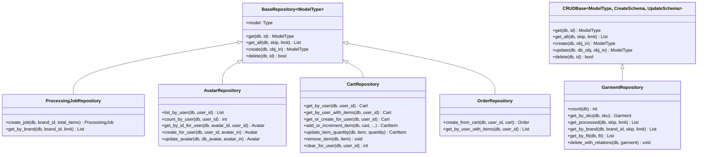
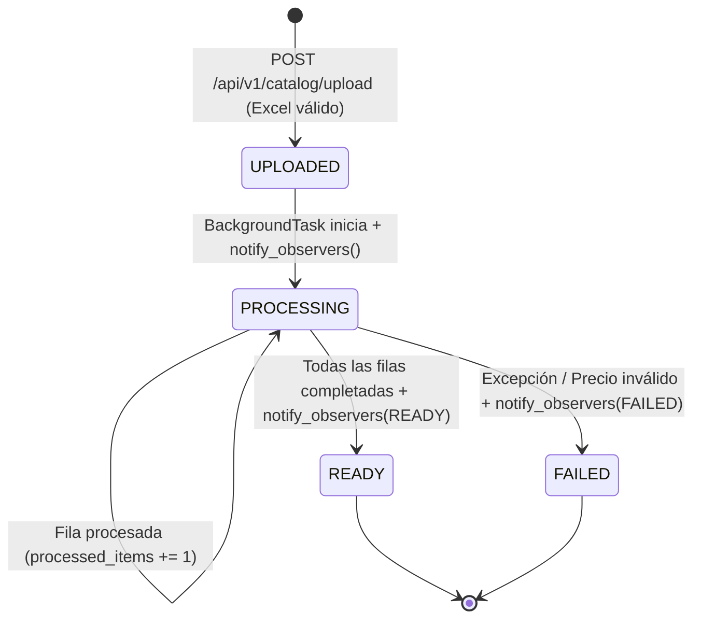
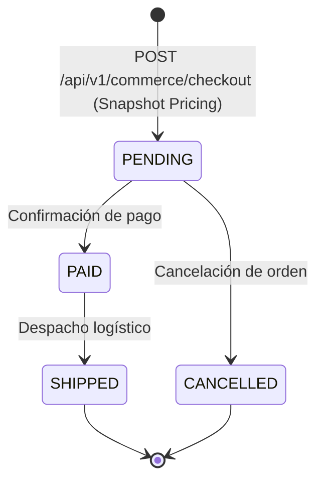
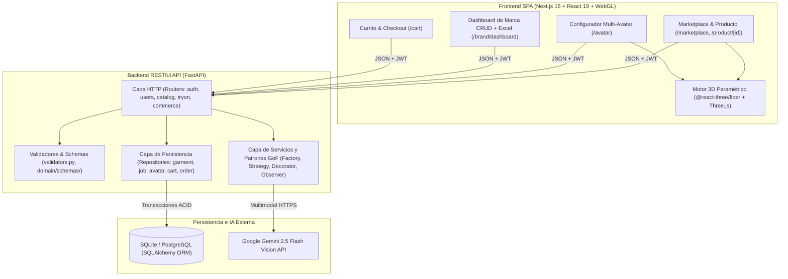

# Diagramas UML Estructurales y de Estado — TryOnHub

Este documento presenta los diagramas estructurales y de comportamiento de **TryOnHub** siguiendo las convenciones de [`UML.pdf`](../../MaterialClase/UML.pdf):
1. **Diagrama de Clases del Modelo de Dominio**
2. **Diagrama de Clases de los Patrones GoF (Strategy, Factory Method, Decorator, Observer)**
3. **Diagrama de Clases del Patrón Repository**
4. **Diagramas de Estado (`ProcessingJob` y `Order`)**
5. **Diagrama de Componentes y Despliegue (Arquitectura multicapa)**

---

## 1. Modelo de Dominio (`app/domain/models/`)

---

## 2. Patrones de Diseño GoF

### 2.1. Strategy Pattern (`app/services/ai_strategy.py`)

---

### 2.2. Factory Method Pattern (`app/services/strategy_factory.py`)

---

### 2.3. Decorator Pattern (`app/services/strategy_decorators.py`)

---

### 2.4. Observer Pattern (`app/services/job_observers.py`)

---

## 3. Patrón Repository (`app/domain/repositories/`)

---

## 4. Diagramas de Estado UML (`UML.pdf` — Comportamiento)

### 4.1. Ciclo de Vida de `ProcessingJob` (Carga Masiva de Catálogo)

### 4.2. Ciclo de Vida de `Order` (Comercio Electrónico)

---

## 5. Diagrama de Paquetes y Componentes (`UML.pdf` — Estructura)

