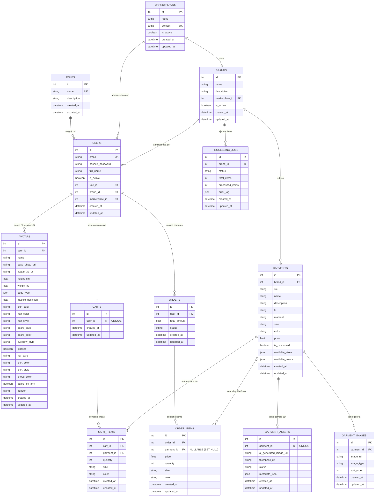

# Diagrama de Entidad-Relación (ERD) — TryOnHub

A continuación se detalla el esquema relacional completo de la base de datos de **TryOnHub**, sincronizado al 100% con los modelos de SQLAlchemy (`app/domain/models/`).

---

## Decisiones Clave de Diseño Relacional
1. **Relación `1:N` entre `USERS` y `AVATARS`:** Un usuario puede gestionar hasta 10 avatares distintos (con migración automática transparente en `app/domain/schema_upgrades.py`).
2. **Separación `GARMENTS` / `GARMENT_ASSETS` / `GARMENT_IMAGES`:** Desacopla los datos comerciales del producto respecto del descriptor paramétrico 3D (`metadata_json`) y la galería de vistas (`FRONT`, `SIDE`, `BACK`), con borrado en cascada (`cascade="all, delete-orphan"`).
3. **Variantes en `CART_ITEMS` y `ORDER_ITEMS` (`size` y `color`):** Cada línea del carrito y de la orden almacena el talle y el color elegidos.
4. **Integridad Histórica en Eliminación de Prendas:** Al eliminar una prenda (`DELETE /api/v1/catalog/garments/{id}`), se eliminan los `CART_ITEMS` activos que la referencian, mientras que los `ORDER_ITEMS` históricos preservan su registro contable (`price`, `quantity`, `size`, `color`) poniendo `garment_id = NULL` (`ondelete="SET NULL"`).
