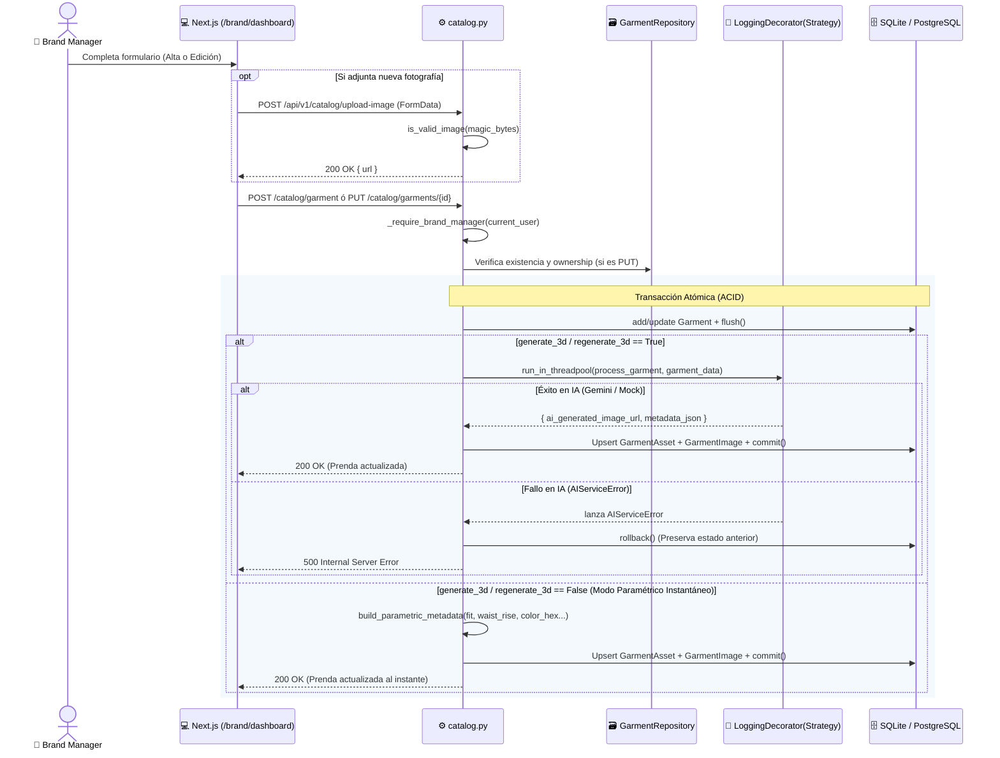
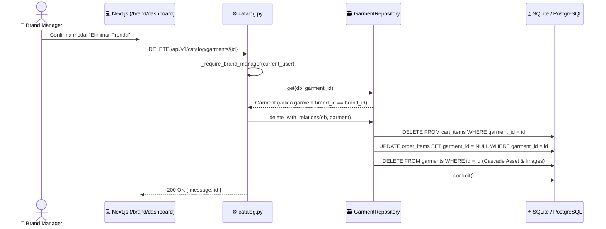
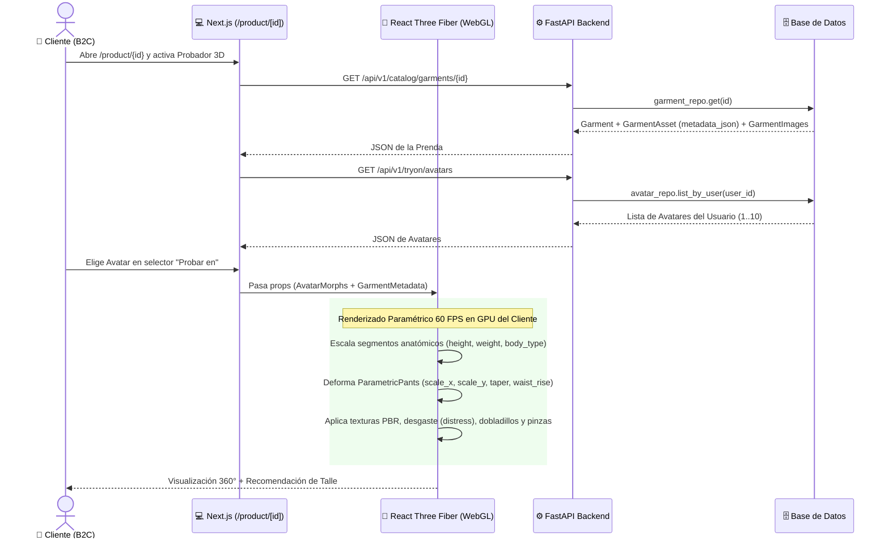
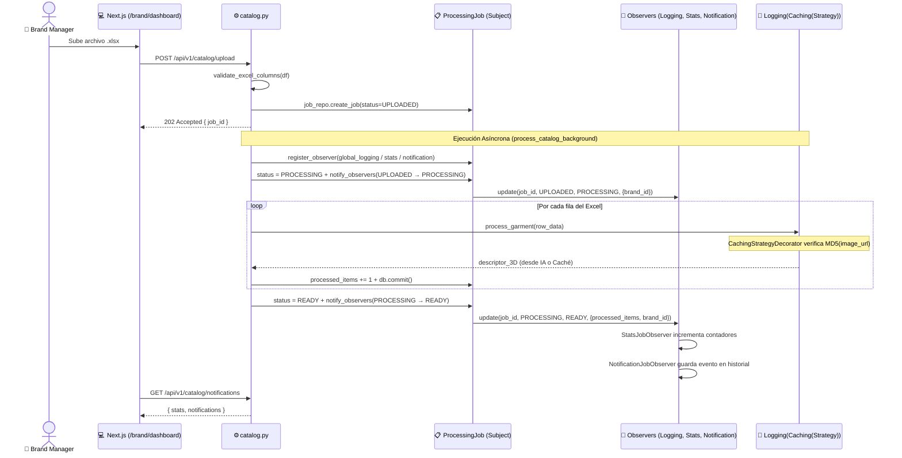
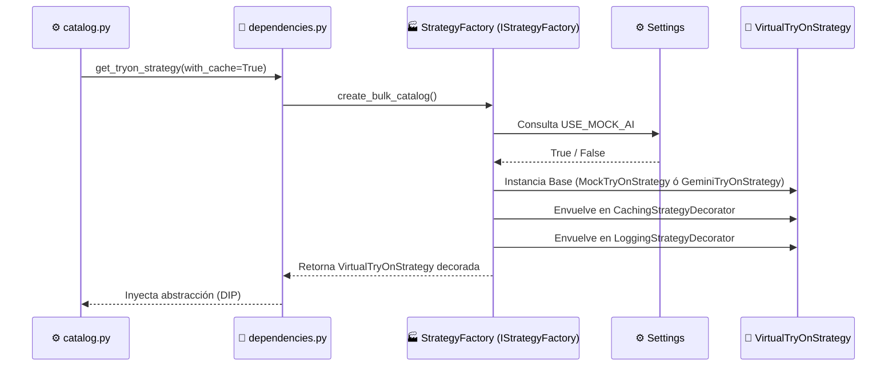

# Diagramas de Secuencia UML — TryOnHub

Este documento presenta los diagramas de secuencia UML para los flujos principales de negocio y patrones de diseño de **TryOnHub**, siguiendo las convenciones de [`UML.pdf`](../../MaterialClase/UML.pdf).

---

## 1. Alta y Edición de Prenda con Inferencia 3D o Paramétrica (`POST /garment` y `PUT /garments/{id}`)

Ilustra la gestión completa de una prenda por parte de la marca, incluyendo la bifurcación entre inferencia por IA (`GeminiTryOnStrategy` envuelta en `LoggingStrategyDecorator`) con rollback atómico en caso de fallo, y el cálculo paramétrico instantáneo (`build_parametric_metadata`).



---

## 2. Eliminación Segura de Prenda (`DELETE /api/v1/catalog/garments/{id}`)

Muestra cómo `GarmentRepository.delete_with_relations` mantiene la integridad referencial eliminando ítems de carritos activos mientras preserva el historial de órdenes cerradas (`OrderItem.garment_id = NULL`).



---

## 3. Probador Virtual 3D Interactivo Multi-Avatar (`Client WebGL`)

Detalla la interacción cuando un cliente selecciona uno de sus avatares 3D para probarse una prenda en tiempo real.



---

## 4. Procesamiento Masivo por Lotes + Patrones Observer y Decorator

Muestra el flujo asíncrono (`BackgroundTasks`) al subir un catálogo Excel, la notificación en modelo **Push** a los tres observadores (`LoggingJobObserver`, `StatsJobObserver`, `NotificationJobObserver`) y la consulta del feed desde el Dashboard.



---

## 5. Flujo de Factory Method (`IStrategyFactory` → `StrategyFactory`)



---

## 6. Carrito por Variante y Checkout con Snapshot Pricing (`CartRepository` & `OrderRepository`)

```mermaid
sequenceDiagram
    actor Cliente as 👤 Cliente
    participant NextJS as 💻 Next.js (/product/[id], /cart)
    participant Router as ⚙️ commerce.py
    participant CartRepo as 🛒 CartRepository
    participant OrderRepo as 📦 OrderRepository
    participant DB as 🗄️ Base de Datos

    Cliente->>NextJS: Elige Talle "32" y Color "Negro" y pulsa "Agregar al Carrito"
    NextJS->>Router: POST /api/v1/commerce/cart { garment_id, quantity, size, color }
    Router->>CartRepo: get_or_create_for_user(user_id)
    Router->>CartRepo: add_or_increment_item(cart, garment_id, quantity, size, color)
    CartRepo->>DB: Si coincide (garment_id + size + color) suma cantidad; sino crea nueva línea
    Router-->>NextJS: 201 Created

    Cliente->>NextJS: Pulsa "Finalizar Compra" en /cart
    NextJS->>Router: POST /api/v1/commerce/checkout
    Router->>CartRepo: get_by_user_with_items(user_id) (con joinedload)
    Router->>OrderRepo: create_from_cart(user_id, cart)
    OrderRepo->>DB: Crea Order + OrderItems congelando garment.price actual (Snapshot Pricing)
    OrderRepo->>DB: Elimina CartItems y ejecuta commit()
    Router-->>NextJS: 201 Created { order_id, total }
```
