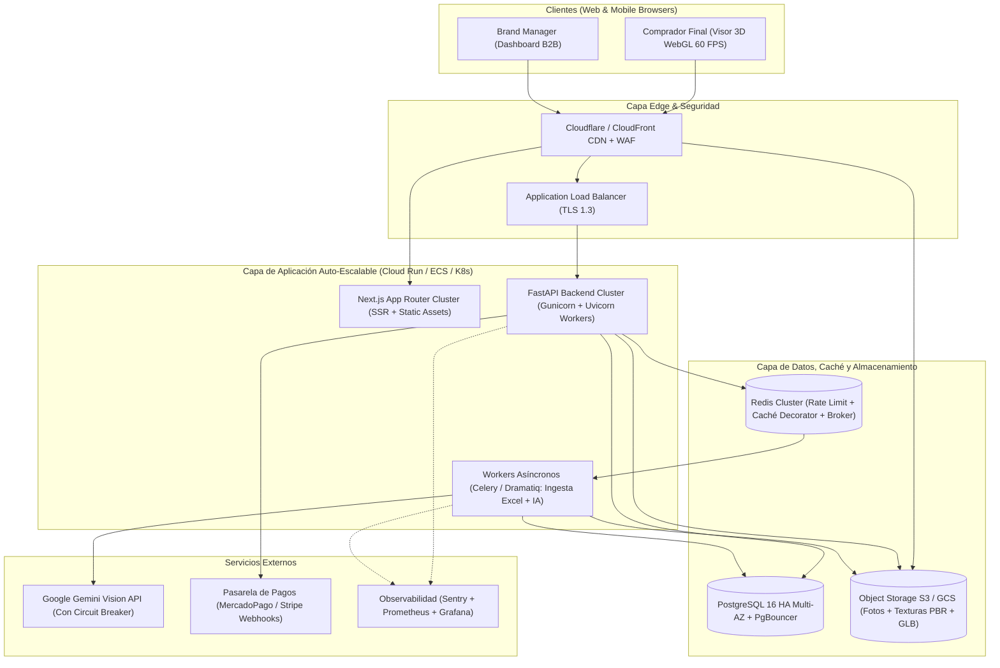

# Modelo de Negocios, Creación de Valor y Plan de Producción: TryOnHub

**TryOnHub** nace con la misión de resolver dos de los problemas más costosos y estructurales del comercio electrónico de indumentaria: la **altísima tasa de devoluciones por errores de talle** y la **baja conversión por incertidumbre de calce**. Nuestra plataforma actúa como un ecosistema **B2B2C** (Business-to-Business-to-Consumer) que conecta marcas de indumentaria con compradores finales a través de **Gemelos Digitales 3D antropométricos en centímetros (`cm`)** e **Inteligencia Artificial Multimodal**.

Este documento integra:
1. El **Marco Estratégico de Creación de Valor** (aplicando la teoría de *Zero to One* de Peter Thiel y *Pattern Breakers* de Mike Maples Jr. y Peter Ziebelman vista en clase).
2. El **Modelo de Monetización, Propuesta de Valor y Go-To-Market**.
3. El **Plan Maestro de Paso a Producción (Production Readiness Roadmap)**, detallando la brecha entre nuestro *Implementation Prototype* actual y una arquitectura *Enterprise-Grade* de alta disponibilidad.

---

## 1. Fundamentos Estratégicos de Creación de Valor (*Material de Clase*)

Como planteaba **Domingo F. Sarmiento (1849)** al analizar la economía política del valor, la riqueza sostenible no proviene de la mera acumulación de insumos físicos, sino del **desarrollo de la capacidad técnica e intelectual aplicada a los procesos productivos**. En la industria de la moda digital, **TryOnHub** transforma un proceso artesanal y subjetivo (adivinar si un pantalón calzará mirando una foto plana) en un **sistema matemático, antropométrico y escalable**.

### 1.1. Teoría de la Inflexión (*Pattern Breakers* — Mike Maples Jr. & Peter Ziebelman)

Las startups que cambian industrias no buscan ser marginalmente mejores compitiendo bajo las reglas existentes (*Pattern Matching*), sino que se apalancan en **puntos de inflexión externos** para proponer un futuro radicalmente distinto (*Pattern Breaking*):

```
[ Inflexión Externa ] ──► [ Insight Non-Consensus ] ──► [ Prototipo de Implementación ] ──► [ Movimiento B2B2C ]
```

#### Test de la Inflexión aplicado a TryOnHub

| Pregunta del Test de la Inflexión | Respuesta Estratégica en TryOnHub |
| :--- | :--- |
| **1. ¿Cuál es la inflexión específica?** | **Triple convergencia tecnológica y económica:**<br>1) **Tecnológica (WebGL 2.0 / Three.js en móviles):** Hoy cualquier navegador móvil o desktop renderiza mallas 3D paramétricas interpoladas a 60 FPS sin instalar apps nativas.<br>2) **IA Multimodal (Gemini 2.5 Flash Vision):** Capacidad de extraer descriptores físicos y geométricos (`waist_rise`, `taper`, `scale_x`, `roughness`, `color_hex`) directamente desde una fotografía 2D de catálogo.<br>3) **Económica/Conductual:** El costo logístico inverso de devoluciones en e-commerce de moda superó el punto de rentabilidad (30%–40% de devoluciones en pantalones y jeans). |
| **2. ¿Qué cambio potente introduce?** | Elimina el costo de digitalización 3D manual (que antes costaba **USD $50–$150 por prenda** en estudios de fotogrametría o CLO3D) reduciéndolo a **centavos de dólar y pocos segundos**, y reemplaza las tablas de talles estáticas por una **comparación geométrica directa en centímetros (`cm`)** entre el cuerpo real del usuario y la moldería real del pantalón. |
| **3. ¿Por qué es relevante hoy y no hace 3 años?** | Hace 3 años los modelos de visión (VLM) no tenían la precisión estructurada ni el bajo costo de latencia/token para inferir parámetros de moldería textil en lote, y los dispositivos móviles de gama media sufrían bloqueos de memoria renderizando geometrías WebGL complejas. |
| **4. ¿Quién gana y quién pierde con este cambio?** | **Ganan:** Marcas D2C medianas y grandes (que acceden a tecnología 3D sin equipo técnico propio) y compradores con cuerpos diversos que no encajan en el "maniquí estándar".<br>**Pierden:** Plataformas de e-commerce estáticas basadas únicamente en fotografía 2D y estudios tradicionales de modelado 3D manual por prenda. |

#### Nuestro Insight *Non-Consensus* (Verdad No Consensuada)
* **La creencia consensuada de la industria:** *"El problema de los talles se resuelve mostrando tablas de medidas más detalladas o recomendadores estadísticos basados en 'usuarios que compraron talle M en otra marca'"*.
* **Nuestra verdad no consensuada (y correcta):** El talle ("S, M, L" o "38, 40, 42") es una **abstracción rota**. Particularmente en pantalones y denim, dos personas del mismo peso y altura tienen contornos de cintura, cadera, muslo y prominencia abdominal completamente distintos. La única forma real de predecir el calce es **cruzar directamente las medidas antropométricas en centímetros (`cm`) del usuario con las dimensiones en centímetros (`cm`) de cada talle de la prenda**, visualizando en 3D dónde sobra o dónde falta tela.

#### Ser Diferente > Ser Mejor (Creación de Categoría)
En lugar de competir como "una tienda online de ropa más bonita", **TryOnHub** define una categoría diferente: un **Hub de Calce Antropométrico 3D**. Así como **General Magic** sembró los prototipos que definieron la telefonía moderna al entender cómo las personas querían interactuar con su identidad digital, nuestro **Implementation Prototype** demuestra en vivo el mecanismo de apalancamiento: el usuario ingresa sus medidas reales en centímetros (`cm`), la marca sube sus prendas con moldería en `cm` o fotografías analizadas por IA, y el motor calcula instantáneamente tanto la deformación 3D como el diagnóstico exacto de holgura o tensión en centímetros.

---

### 1.2. Los 4 Pilares del Monopolio Creativo (*Zero to One* — Peter Thiel)

Para escapar de la competencia perfecta y construir un negocio defensible (*Zero to One*), TryOnHub se estructura sobre las cuatro características del monopolio tecnológico de Peter Thiel:

1. **Tecnología Propia (Ventaja 10x sobre el sustituto más cercano):**
   - **Digitalización 10x más rápida para marcas:** Mientras que el modelado 3D tradicional requiere diseñadores CAD textiles, nuestro pipeline combina el patrón **Strategy + Decorator** (`GeminiTryOnStrategy` envuelto en `CachingStrategyDecorator` y `LoggingStrategyDecorator`) con generación paramétrica determinística (`build_parametric_metadata`) para transformar una foto 2D o una planilla Excel en un gemelo digital 3D listo para probarse en segundos.
   - **Precisión 10x superior para el comprador:** Nuestro motor `LoftGeometry` construye superficies anatómicas continuas $C^1$ impulsadas por medidas reales en centímetros (`cm` de pecho, cintura, prominencia abdominal, cadera, muslo, brazo y cuello) y las compara matemáticamente contra los centímetros reales de cintura, cadera y tiro/largo de la prenda.

2. **Efectos de Red B2B2C (Cross-Side Network Effects):**
   - **Un solo Gemelo Digital, múltiples marcas:** Cuando un comprador se mide una sola vez con cinta métrica y guarda su Avatar 3D en `cm` dentro de TryOnHub (o los avatares de su familia, hasta 10 perfiles por cuenta), el costo de cambio (*switching cost*) se vuelve altísimo.
   - **Ciclo virtuoso:** Más usuarios con avatares guardados en `cm` $\rightarrow$ mayor tasa de conversión para las marcas en el Hub $\rightarrow$ más marcas integran sus catálogos $\rightarrow$ mayor utilidad para el usuario final.

3. **Economías de Escala (Costo Marginal Cercano a Cero):**
   - **Renderizado distribuido en el borde (Client-Side GPU):** A diferencia de los sistemas de *Virtual Try-On* basados en difusión de imagen server-side (que cuestan entre USD \$0.04 y \$0.15 de GPU en la nube **cada vez** que un usuario se prueba una prenda), TryOnHub ejecuta la inferencia de IA **una única vez** cuando la marca sube la prenda (y la almacena en caché mediante `CachingStrategyDecorator`). Luego, millones de pruebas virtuales 3D ocurren en el navegador del comprador usando su propia placa gráfica vía WebGL/Three.js con **costo marginal \$0.00 para nuestros servidores**.

4. **Construcción de Marca y Movimiento (*Co-conspiradores*):**
   - Empoderamos a las primeras marcas *early-adopters* como **co-conspiradores** del movimiento hacia el *"E-Commerce de Devolución Cero"*, posicionando el sello **"Probado en TryOnHub 3D"** como garantía de confianza antropométrica.

---

## 2. Propuesta de Valor Dual

### Para las Marcas (B2B)
* **Digitalización Automática y Masiva:** Las marcas no necesitan diseñadores 3D. Suben su catálogo en **Excel (`.xlsx`/`.xls`)** o cargan una prenda individual con fotografía e información de moldería en `cm`, y nuestro pipeline asíncrono genera los activos 3D automáticamente.
* **Control Antropométrico en Centímetros:** Desde el *Dashboard de Marca*, el gestor define o ajusta las medidas base en centímetros (`Cintura cm`, `Cadera cm`, `Largo de Tiro/Pierna cm`) junto con el corte (`Skinny`, `Regular`, `Mom Fit`, `Wide Leg`, `Flared`, `Bermuda`, `Skirt`), permitiendo que el probador refleje fielmente el patronaje real de cada marca.
* **Drástica Reducción de Devoluciones:** Al mostrar visual y numéricamente en centímetros si un talle queda ajustado (con pliegues de tensión en 3D) u holgado (con caída y acumulación en botamanga), se reducen los cambios por talle incorrecto entre un **25% y un 40%**.
* **Aumento en la Tasa de Conversión:** La experiencia interactiva incrementa la confianza de compra y el tiempo de permanencia en página.

### Para los Compradores (B2C)
* **Creador de Gemelos Digitales en Centímetros Reales (`cm`):** A diferencia de los probadores basados en porcentajes abstractos, el usuario modela su cuerpo ingresando sus medidas reales en centímetros (**Altura**, **Contorno de Pecho**, **Contorno de Busto**, **Contorno de Cintura**, **Proyección Abdominal**, **Contorno de Cadera**, **Contorno de Muslo**, **Contorno de Brazo** y **Contorno de Cuello**).
* **Gestión Familiar Multi-Avatar:** Permite almacenar hasta **10 gemelos digitales por cuenta** (por ejemplo, para comprar ropa para hijos o pareja) y alternar entre ellos con un clic dentro del probador virtual.
* **Diagnóstico Inteligente de Calce en Tiempo Real:** El sistema compara los centímetros del talle seleccionado contra los centímetros de cintura y cadera del avatar, informando la holgura o compresión exacta en `cm` y adaptando la malla 3D al instante.

---

## 3. Vías de Monetización (Revenue Streams) y Unit Economics

El modelo de ingresos de **TryOnHub** es híbrido, combinando ingresos recurrentes predecibles (**SaaS**) con ingresos variables alineados al éxito comercial de las marcas (**Transactional / Success Fee**):

### 3.1. Suscripción SaaS para Marcas (B2B Tiered Pricing)
Cobro mensual recurrente según el volumen de SKUs activos y procesamiento 3D en el catálogo:
* **Plan Starter (Marcas Emergentes / D2C — USD \$49/mes):** Hasta 50 prendas activas en el catálogo 3D, carga individual y 100 créditos mensuales de generación IA Vision.
* **Plan Growth (Marcas Medianas — USD \$199/mes):** Hasta 500 prendas activas, ingesta masiva por Excel asíncrona, personalización de tabla de moldería en `cm` y analíticas de talles más probados.
* **Plan Enterprise (Grandes Retailers — USD \$799+/mes):** SKUs ilimitados, integración vía API/Webhooks con Shopify, Tiendanube, VTEX o WooCommerce, soporte prioritario con SLA del 99.9% y *White-Labeling* (incrustar el visor 3D de TryOnHub directamente en el dominio de la marca).

### 3.2. Comisión por Transacción Atribuida (Marketplace Success Fee)
* Por cada venta completada dentro del marketplace de **TryOnHub** —o en el e-commerce de la marca tras una sesión activa en el Probador Virtual 3D—, se cobra una comisión (**Take Rate**) del **5% al 8%** sobre el *Gross Merchandise Value (GMV)*.
* Este modelo reduce la fricción de entrada para nuevas marcas: pagan variable únicamente cuando TryOnHub les genera ventas reales y medibles.

### 3.3. Créditos de Generación IA "Pay-As-You-Go"
* Las marcas que superen el límite mensual de digitalizaciones 3D de su plan pueden adquirir paquetes de créditos adicionales (**USD \$0.15 por SKU procesado** frente a un costo subyacente de API de ~USD \$0.002 en Gemini Flash, logrando un **margen bruto > 95%** en procesamiento IA).

### 3.4. Analítica Antropométrica Agregada (Data-as-a-Service B2B)
* Las marcas suelen fabricar curvas de talles a ciegas (quedándose sin stock en talles centrales y acumulando liquidaciones en extremos).
* TryOnHub ofrece reportes anonimizados de **demanda insatisfecha por morfología en `cm`** (ej. *"El 28% de los usuarios que probaron tu Jean Mom Fit tenían 76 cm de cintura y 106 cm de cadera, donde tu moldería actual genera tensión en cadera"*), permitiendo optimizar la producción textil de la siguiente temporada.

---

## 4. Estrategia de Go-To-Market (Fases de Lanzamiento)

Siguiendo la regla de Peter Thiel (*"Domina primero un nicho pequeño y concéntrico antes de expandirte"*):

1. **Fase 1 — Dominio del Nicho Crítico (Denim y Pantalones en Marcas D2C Locales):**
   * El pantalón/jean es la prenda con mayor dolor de calce y mayor tasa de devolución del mercado.
   * Captación de las primeras **15–30 marcas D2C de denim** (nuestros *co-conspiradores*) mediante *onboarding* sin costo fijo inicial y carga asistida de sus catálogos vía Excel.
2. **Fase 2 — Expansión de Categorías y Plugins E-Commerce:**
   * Lanzamiento de plugins *one-click* para **Tiendanube, Shopify y VTEX**, permitiendo que el botón *"Probar en mi Avatar 3D (cm)"* viva tanto en el Marketplace de TryOnHub como en la tienda propia de cada marca.
   * Incorporación de prendas superiores (camisas, blazers, camperas) apalancando las medidas de pecho, hombros, cuello y brazos que el usuario ya registró en su Gemelo Digital.

---

## 5. Plan Maestro de Paso a Producción (Production Readiness Roadmap)

Actualmente, **TryOnHub** constituye un **Implementation Prototype funcional de alta fidelidad** que cumple rigurosamente con los patrones arquitectónicos de ingeniería de software (**Capas, Repository, Strategy, Decorator, Observer, Inyección de Dependencias, JWT con claims estándar, Docker multi-stage y suite de 42 tests automatizados con Pytest**).

Sin embargo, para operar con **miles de usuarios concurrentes, acuerdos de nivel de servicio (SLA 99.9%) y transacciones financieras reales en producción**, es necesario evolucionar los componentes de prototipo hacia una infraestructura **Enterprise-Grade**. A continuación se detalla el diagnóstico técnico completo y el plan de ingeniería para pasar a producción:

### 5.1. Matriz Diagnóstica: Estado Actual vs. Producción Enterprise

| Dimensión Arquitectónica | Estado Actual en el Repositorio (*Implementation Prototype*) | Qué le falta para ser 100% Robusto en Producción (*Enterprise Target*) |
| :--- | :--- | :--- |
| **1. Base de Datos y Migraciones** | SQLAlchemy 2.0 (`DeclarativeBase`) con soporte dual SQLite/PostgreSQL (`normalize_database_url`) y script idempotente `schema_upgrades.py` ejecutado en el `lifespan`. | • Migrar a **PostgreSQL 16 Gestionado (AWS RDS Multi-AZ / Cloud SQL)**.<br>• Reemplazar `create_all()` y `schema_upgrades.py` por migraciones versionadas con **Alembic**.<br>• Incorporar **PgBouncer** para *connection pooling* transaccional.<br>• Configurar **Backups Automáticos con Point-in-Time Recovery (PITR)** y réplicas de lectura para el catálogo público. |
| **2. Almacenamiento de Imágenes y Activos 3D** | Guardado en sistema de archivos local del contenedor (`backend/static/uploads/`) con fallback inteligente a imágenes base si el contenedor se recrea. | • El almacenamiento en disco local es efímero en contenedores escalados horizontalmente.<br>• Migrar a **Object Storage (AWS S3 / Google Cloud Storage / Cloudflare R2)**.<br>• Implementar subida directa desde el cliente mediante **Presigned URLs**.<br>• Servir imágenes y texturas a través de una **CDN Global (CloudFront / Cloudflare)** con compresión automática WebP/AVIF. |
| **3. Procesamiento Asíncrono y Colas (Excel & IA)** | `FastAPI BackgroundTasks` ejecutando `process_catalog_background` en el mismo proceso web y patrón `Observer` en memoria (`global_stats_observer`, `global_notification_observer`). | • Si el worker web se reinicia durante un despliegue, las tareas en `BackgroundTasks` y las notificaciones en memoria se pierden.<br>• Desacoplar mediante un broker de mensajes (**Redis / RabbitMQ**) y workers dedicados con **Celery o Dramatiq**.<br>• Persistir los eventos de los *Observers* en base de datos (`job_notifications` table) + emitir progreso en vivo por **Server-Sent Events (SSE) o WebSockets**.<br>• Configurar **Dead-Letter Queues (DLQ)** y *Exponential Backoff* ante límites de cuota (HTTP 429) de Gemini API. |
| **4. Autenticación, Seguridad y Secretos** | JWT (`HS256`) con claims estándar (`sub`, `iat`, `role`, `exp`), contraseñas con `bcrypt`, validación estricta de `SECRET_KEY` en `settings.py` y almacenamiento del token en `localStorage`. | • Implementar par de **Access Token (15 min) + Refresh Token rotativo (7 días)** almacenado en cookies **`HttpOnly; Secure; SameSite=Strict`** para mitigar cualquier vector XSS.<br>• Añadir **Rate Limiting distribuido con Redis (`SlowAPI`)** en `/auth/login`, `/auth/register` y `/catalog/upload` para prevenir fuerza bruta y abuso de IA.<br>• Inyectar secretos desde **AWS Secrets Manager / GCP Secret Manager**.<br>• Configurar **WAF (Web Application Firewall)**, cabeceras **CSP / HSTS** y auditoría de privacidad para datos antropométricos (**LPDP Argentina / GDPR**). |
| **5. Pasarela de Pagos y Checkout Transaccional** | Carrito persistente en base de datos (`/commerce/cart`) con validación de stock/existencia y limpieza de carrito al confirmar. | • Crear entidades persistentes `Order`, `OrderItem`, `PaymentTransaction` y `CommissionLedger` (libro mayor para auditar el *Success Fee* de cada marca).<br>• Integrar **MercadoPago Checkout Pro / Stripe Payment Intents** con validación criptográfica de **Webhooks (`HMAC-SHA256`)** e **Idempotency Keys** para evitar cobros duplicados. |
| **6. Motor 3D e IA Generativa** | Motor paramétrico `LoftGeometry` en Three.js / React Three Fiber impulsado por medidas en `cm` + análisis multimodal con `Gemini 2.5 Flash`. | • Evolucionar la inferencia visual para generar **mapas de normales/textura (PBR)** a partir de la foto real de la prenda.<br>• Soportar exportación y carga de mallas estándar **glTF / GLB comprimidas con Draco**.<br>• Implementar **Caché Semántico Distribuido en Redis** (reemplazando el dict en memoria de `CachingStrategyDecorator`) para compartir inferencias entre múltiples réplicas del backend. |
| **7. Contenedores, CI/CD y Despliegue** | `Dockerfile` multi-stage con usuario `appuser` non-root, `.dockerignore`, `docker-compose.yml` orquestado con healthchecks y pipeline GitHub Actions (`.github/workflows/main.yml`). | • Ampliar el pipeline CI/CD con: **1) Linting & Typecheck** (`ruff`, `mypy`, `eslint`, `tsc --noEmit`), **2) Tests de Integración con PostgreSQL real en contenedor de servicio**, **3) Escaneo de vulnerabilidades** (`Trivy` / `pip-audit` / `npm audit`), y **4) Despliegue continuo Blue-Green** hacia **Google Cloud Run / AWS ECS Fargate** (Backend) y **Vercel / CloudFront** (Frontend). |
| **8. Observabilidad, Monitoreo y FinOps** | `LoggingJobObserver` con `logging` estándar de Python y endpoint de salud `/health`. | • Implementar **Logging Estructurado JSON (`structlog`)** con `X-Request-ID` / `Correlation-ID` en cada petición.<br>• Integrar **Sentry** en Next.js y FastAPI para alerta temprana de errores en producción.<br>• Exponer métricas **OpenTelemetry / Prometheus** (latencia p95/p99 de endpoints, tiempo de inferencia Gemini, FPS promedio del visor 3D y consumo de tokens por marca). |

---

### 5.2. Arquitectura Objetivo de Producción (Diagrama de Despliegue Cloud)



---

### 5.3. Hoja de Ruta de Ingeniería hacia Producción (4 Sprints de Consolidación)

#### Fase 1: Persistencia Industrial y Almacenamiento Desacoplado (Semanas 1–2)
1. Inicializar **Alembic** (`alembic init migrations`) generando la migración base a partir de `Base.metadata` y bloqueando cambios manuales de esquema en producción.
2. Implementar el adaptador `StorageService` (patrón **Strategy** para almacenamiento: `LocalDiskStorage` en desarrollo/test y `S3CompatibleStorage` con `boto3` en producción).
3. Migrar `CachingStrategyDecorator` para utilizar **Redis** con TTL configurable (ej. 30 días por hash SHA-256 de imagen + parámetros de moldería).

#### Fase 2: Colas Distribuidas y Seguridad Reforzada (Semanas 3–4)
1. Reemplazar `BackgroundTasks` en `/catalog/upload` por tareas distribuidas en **Celery + Redis**, persistiendo las notificaciones de los `JobObservers` en PostgreSQL para que sobrevivan reinicios de contenedores.
2. Incorporar **Refresh Tokens** en cookies `HttpOnly`, rotación automática en `/auth/refresh` y **Rate Limiting** por IP/usuario.

#### Fase 3: Motor Transaccional de Pagos y Liquidación B2B (Semanas 5–6)
1. Modelar las tablas transaccionales `orders`, `order_items` y `brand_payouts` con bloqueo pesimista (`SELECT ... FOR UPDATE`) para control de inventario por talle.
2. Integrar **Webhooks firmados** de MercadoPago/Stripe para confirmar órdenes de forma asíncrona y registrar automáticamente el *Success Fee* (5%–8%) de TryOnHub.

#### Fase 4: Observabilidad, Pruebas de Carga y Lanzamiento (Semanas 7–8)
1. Ejecutar pruebas de carga con **Locust / k6** simulando picos de tráfico de *Hot Sale / CyberMonday* (1.000 usuarios concurrentes probándose prendas en 3D y 50 marcas importando catálogos simultáneamente).
2. Activar tableros **Grafana + Sentry**, validación E2E automatizada con **Playwright** en el pipeline de GitHub Actions y puesta en marcha con las primeras marcas *co-conspiradoras*.
