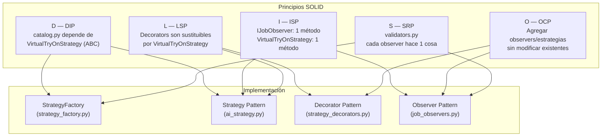

# Principios SOLID en TryOnHub

Este documento mapea cada principio **SOLID** (del material de clase [`SOLID_uns.pdf`](../MaterialClase/SOLID_uns.pdf)) a código concreto del proyecto.

---

## S — Single Responsibility Principle (SRP)

> *"A class should have only one reason to change."*

| Módulo | Responsabilidad única |
|--------|----------------------|
| [`app/routers/catalog.py`](../backend/app/routers/catalog.py) | Orquestra el flujo HTTP del catálogo (recibir request, delegar, responder). |
| [`app/routers/validators.py`](../backend/app/routers/validators.py) | **Solo** valida entradas: magic bytes de imagen, columnas Excel, parseo de precio. |
| [`app/services/ai_strategy.py`](../backend/app/services/ai_strategy.py) | **Solo** define el contrato y la lógica de análisis de IA. |
| [`app/services/strategy_decorators.py`](../backend/app/services/strategy_decorators.py) | **Solo** agrega comportamiento transversal (logging, caché) sin modificar las estrategias. |
| [`app/services/strategy_factory.py`](../backend/app/services/strategy_factory.py) | **Solo** construye la cadena de decoradores (sabe *cómo* ensamblar, no *qué hace* cada pieza). |
| [`app/services/job_observers.py`](../backend/app/services/job_observers.py) | Cada observer concreto tiene **una** responsabilidad: `LoggingJobObserver` loguea, `StatsJobObserver` cuenta, `NotificationJobObserver` notifica. |
| [`app/domain/repositories/`](../backend/app/domain/repositories/) | Cada repositorio encapsula el acceso a datos de **una** entidad de dominio. |

**¿Por qué importa?**
Antes de extraer `validators.py`, `catalog.py` tenía dos razones para cambiar: si cambiaba la lógica de negocio del catálogo *o* si cambiaban los formatos de imagen soportados. Ahora cada módulo cambia por **una sola razón**.

---

## O — Open/Closed Principle (OCP)

> *"Software entities should be open for extension, but closed for modification."*

### Ejemplo 1: Observer Pattern

El `ProcessingJob` (Subject) está **cerrado a modificación**. Para agregar `NotificationJobObserver` bastó:

```python
# catalog.py — solo agregar tres líneas, nada se modificó
notification_obs = NotificationJobObserver()
job.register_observer(notification_obs)
```

Si mañana se quiere agregar un `SlackJobObserver` o un `WebSocketJobObserver`, el proceso es **idéntico**. `ProcessingJob` y los observers existentes no se tocan.

### Ejemplo 2: Strategy Pattern

`GeminiTryOnStrategy` y `MockTryOnStrategy` están **cerradas**. Si el cliente quiere usar OpenAI en lugar de Gemini:

```python
# Nuevo archivo: openai_strategy.py
class OpenAITryOnStrategy(VirtualTryOnStrategy):
    def process_garment(self, garment_data: dict) -> dict:
        ...  # lógica OpenAI

# strategy_factory.py — solo este archivo cambia
def _create_base(self) -> VirtualTryOnStrategy:
    if self._settings.USE_OPENAI:
        return OpenAITryOnStrategy()
    ...
```

`catalog.py`, `tryon.py` y todos los routers: **cero cambios**.

### Ejemplo 3: Decorator Pattern

`LoggingStrategyDecorator` y `CachingStrategyDecorator` no tocan `GeminiTryOnStrategy`. Se pueden apilar en cualquier orden, o agregar un `RetryStrategyDecorator`, sin modificar nada existente.

---

## L — Liskov Substitution Principle (LSP)

> *"Subtypes must be substitutable for their base types."*

Toda la arquitectura de Strategy se apoya en este principio:

```python
# catalog.py solo conoce VirtualTryOnStrategy
strategy: VirtualTryOnStrategy = get_tryon_strategy(with_cache=True)
result = strategy.process_garment(garment_data)
# ↑ Funciona igual si strategy es:
#   GeminiTryOnStrategy, MockTryOnStrategy,
#   LoggingStrategyDecorator, CachingStrategyDecorator,
#   o cualquier combinación de decoradores.
```

`StrategyDecorator` hereda de `VirtualTryOnStrategy`, por lo que **cualquier decorador es también una estrategia válida**. El router no sabe ni le importa si está hablando con Gemini o con una cadena de decoradores.

---

## I — Interface Segregation Principle (ISP)

> *"Clients should not be forced to depend on interfaces they don't use."*

### IJobObserver — interfaz mínima

```python
class IJobObserver(ABC):
    @abstractmethod
    def update(self, job_id, old_status, new_status, context) -> None: ...
```

La interfaz del Observer tiene **un único método**. `LoggingJobObserver`, `StatsJobObserver` y `NotificationJobObserver` implementan solo lo que necesitan. Ningún observer está forzado a implementar métodos de otro (como `summary()` de `StatsJobObserver`, que es un método de conveniencia propio).

### VirtualTryOnStrategy — interfaz mínima

```python
class VirtualTryOnStrategy(ABC):
    @abstractmethod
    def process_garment(self, garment_data: dict) -> dict: ...
```

Un único método de contrato. Nada de getters/setters obligatorios ni helpers que no todas las estrategias necesitarían.

---

## D — Dependency Inversion Principle (DIP)

> *"High-level modules should not depend on low-level modules. Both should depend on abstractions."*

| Módulo de alto nivel | Depende de (abstracción) | No depende de (concreción) |
|---------------------|--------------------------|---------------------------|
| `catalog.py` | `VirtualTryOnStrategy` | `GeminiTryOnStrategy`, `MockTryOnStrategy` |
| `catalog.py` | `IJobObserver` (via mixin) | `LoggingJobObserver`, `StatsJobObserver` |
| `dependencies.py` | `VirtualTryOnStrategy` | `StrategyDecorator`, `GeminiTryOnStrategy` |
| `tryon.py` | `AvatarRepository` (interfaz base) | ORM SQLAlchemy directo |

La **inyección de dependencias** de FastAPI (`Depends(get_garment_tryon_strategy)`) es el mecanismo concreto que implementa DIP: el router declara que necesita una `VirtualTryOnStrategy`, y el contenedor (FastAPI + `dependencies.py`) decide cuál concreción inyectar, incluyendo la posibilidad de `dependency_overrides` en tests.

```python
# catalog.py — depende de la abstracción, no de la concreción
@router.post("/garment")
async def create_garment(
    ...
    strategy: Optional[VirtualTryOnStrategy] = Depends(get_garment_tryon_strategy),
):
    result = strategy.process_garment(garment_data)  # polimorfismo puro
```

---

## Resumen visual



> [!NOTE]
> Los principios SOLID no son alternativas entre sí — el código de TryOnHub los aplica **simultáneamente**. El Decorator Pattern cumple OCP y LSP al mismo tiempo. El Factory Pattern cumple SRP y DIP. Así se diseña software que escala.
