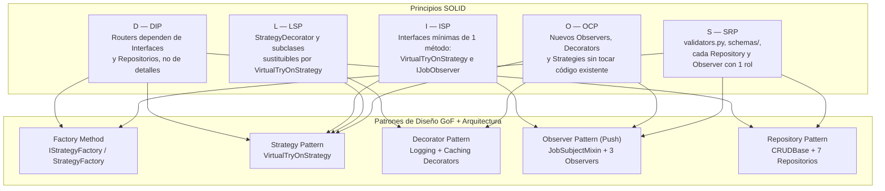

# Patrones de Diseño GoF y Principios SOLID en TryOnHub

Este documento vincula cada principio **SOLID** y cada **Patrón de Diseño GoF** del material de la cátedra ([`SOLID_uns.pdf`](../../MaterialClase/SOLID_uns.pdf), [`Patron_Decorator.pdf`](../../MaterialClase/Patron_Decorator.pdf), [`Patron_Observer.pdf`](../../MaterialClase/Patron_Observer.pdf) y [`Patrón Factory.pdf`](../../MaterialClase/Patr%C3%B3n%20Factory.pdf)) con su implementación real en el código de **TryOnHub**.

---

## 1. Principios SOLID Aplicados

### S — Single Responsibility Principle (SRP)
> *"Una clase o módulo debe tener una, y solo una, razón para cambiar."*

| Módulo / Clase | Responsabilidad Única |
|----------------|-----------------------|
| [`app/routers/catalog.py`](../backend/app/routers/catalog.py) | Orquesta los endpoints HTTP del catálogo (autorización RBAC, delegación a repositorios/estrategias y respuesta HTTP). |
| [`app/routers/commerce.py`](../backend/app/routers/commerce.py) | Orquesta los endpoints HTTP de carrito y órdenes delegando el 100% de la persistencia a `cart_repo` y `order_repo`. |
| [`app/routers/validators.py`](../backend/app/routers/validators.py) | **Solo** valida entradas: *magic bytes* de imágenes (`is_valid_image`), columnas requeridas de Excel (`validate_excel_columns`) y precios (`parse_price`). |
| [`app/domain/schemas/catalog.py`](../backend/app/domain/schemas/catalog.py) | **Solo** define los DTOs de entrada (`GarmentCreate`, `GarmentUpdate`) y el cálculo determinístico de metadatos 3D (`build_parametric_metadata`). |
| [`app/services/ai_strategy.py`](../backend/app/services/ai_strategy.py) | **Solo** define el contrato `VirtualTryOnStrategy` y las estrategias concretas de inferencia 3D (`GeminiTryOnStrategy`, `MockTryOnStrategy`). |
| [`app/services/strategy_decorators.py`](../backend/app/services/strategy_decorators.py) | **Solo** agrega responsabilidades transversales (*logging* de tiempos y *caching* MD5 en memoria) sin alterar las estrategias base. |
| [`app/services/strategy_factory.py`](../backend/app/services/strategy_factory.py) | **Solo** encapsula la creación y el ensamblaje de la cadena de estrategias y decoradores (`IStrategyFactory` / `StrategyFactory`). |
| [`app/services/job_observers.py`](../backend/app/services/job_observers.py) | Cada observer concreto tiene **una** razón de cambio: `LoggingJobObserver` audita en logs, `StatsJobObserver` contabiliza métricas y `NotificationJobObserver` gestiona alertas de negocio. |
| [`app/domain/repositories/`](../backend/app/domain/repositories/) | Cada repositorio (`UserRepository`, `GarmentRepository`, `ProcessingJobRepository`, `AvatarRepository`, `CartRepository`, `OrderRepository`) encapsula las consultas ORM de su entidad. |

---

### O — Open/Closed Principle (OCP)
> *"Las entidades de software deben estar abiertas para su extensión, pero cerradas para su modificación."*

1. **Extensión de Observadores (`Observer Pattern`):**
   - `ProcessingJob` (el *Subject*) está **cerrado a la modificación**. Cuando se incorporó `NotificationJobObserver` para alimentar el feed de notificaciones del Dashboard de Marca (`GET /api/v1/catalog/notifications`), no se modificó ni una sola línea de `ProcessingJob`, `LoggingJobObserver` ni `StatsJobObserver`.
2. **Extensión de Motores de IA (`Strategy Pattern`):**
   - Si se desea incorporar `OpenAITryOnStrategy` o `ClaudeVisionStrategy`, basta con crear una subclase de `VirtualTryOnStrategy` y registrarla en `StrategyFactory`. Los routers `catalog.py` y `tryon.py` permanecen intactos.
3. **Extensión de Capacidades Transversales (`Decorator Pattern`):**
   - `LoggingStrategyDecorator` y `CachingStrategyDecorator` envuelven cualquier `VirtualTryOnStrategy` dinámicamente sin modificar el código de `GeminiTryOnStrategy`.

---

### L — Liskov Substitution Principle (LSP)
> *"Los subtipos deben ser sustituibles por sus tipos base sin alterar el correcto funcionamiento del programa."*

Tanto las estrategias concretas (`GeminiTryOnStrategy`, `MockTryOnStrategy`) como los decoradores (`StrategyDecorator`, `LoggingStrategyDecorator`, `CachingStrategyDecorator`) heredan de `VirtualTryOnStrategy` y respetan estrictamente la firma y postcondiciones de `process_garment(garment_data: dict) -> dict` (retornando siempre `ai_generated_image_url` y `metadata_json`).

```python
# catalog.py opera sobre el tipo base VirtualTryOnStrategy sin conocer el subtipo real:
strategy: VirtualTryOnStrategy = get_tryon_strategy(with_cache=True)
asset_data = strategy.process_garment(garment_data)
```

---

### I — Interface Segregation Principle (ISP)
> *"Los clientes no deben verse forzados a depender de interfaces que no utilizan."*

- **`VirtualTryOnStrategy`**: define un único método abstracto (`process_garment`).
- **`IJobObserver`**: define un único método abstracto (`update`). Los métodos específicos como `summary()` en `StatsJobObserver` o `get_notifications()` en `NotificationJobObserver` pertenecen únicamente a las clases concretas que los requieren, manteniendo la interfaz base minimalista y cohesiva.
- **`IStrategyFactory`**: expone únicamente los métodos de creación de producto (`create_single_garment` y `create_bulk_catalog`).

---

### D — Dependency Inversion Principle (DIP)
> *"Los módulos de alto nivel no deben depender de módulos de bajo nivel. Ambos deben depender de abstracciones."*

| Módulo de Alto Nivel | Depende de la Abstracción | Concreción Oculta / Inyectada |
|----------------------|---------------------------|-------------------------------|
| `catalog.py` | `VirtualTryOnStrategy` (vía `Depends`) | `LoggingStrategyDecorator(CachingStrategyDecorator(GeminiTryOnStrategy))` |
| `catalog.py` | `IJobObserver` (vía `JobSubjectMixin`) | `LoggingJobObserver`, `StatsJobObserver`, `NotificationJobObserver` |
| `catalog.py` | `GarmentRepository`, `ProcessingJobRepository` | Consultas SQLAlchemy sobre `Garment`, `CartItem`, `OrderItem`, `ProcessingJob` |
| `commerce.py` | `CartRepository`, `OrderRepository`, `GarmentRepository` | Consultas SQLAlchemy con `joinedload` sobre `Cart`, `CartItem`, `Order`, `OrderItem` |
| `tryon.py` | `AvatarRepository`, `GarmentRepository` | Consultas SQLAlchemy sobre `Avatar` y `Garment` |

---

## 2. Profundización Académica de los Patrones GoF (Material de Clase)

### 2.1. Patrón Decorator (`strategy_decorators.py` vs. *Starbuzz Coffee* de `Patron_Decorator.pdf`)
En las diapositivas de cátedra (*Starbuzz Coffee*), `Beverage` es el `Component` abstracto, `Espresso`/`HouseBlend` son `ConcreteComponents` y `CondimentDecorator` (`Mocha`, `Whip`) hereda de `Beverage` **para igualar el tipo**, pero contiene una referencia `beverage: Beverage` **por composición para añadir comportamiento**.

En **TryOnHub**, la correspondencia es exacta:
- **`Component`:** [`VirtualTryOnStrategy`](../backend/app/services/ai_strategy.py)
- **`ConcreteComponents`:** [`GeminiTryOnStrategy`](../backend/app/services/ai_strategy.py) y [`MockTryOnStrategy`](../backend/app/services/ai_strategy.py)
- **`Decorator` abstracto:** [`StrategyDecorator`](../backend/app/services/strategy_decorators.py) (hereda de `VirtualTryOnStrategy` y compone `self._wrapped: VirtualTryOnStrategy`)
- **`ConcreteDecorators`:**
  - [`CachingStrategyDecorator`](../backend/app/services/strategy_decorators.py): Calcula el hash MD5 de `image_url`; si ya fue procesada en el lote, retorna el descriptor en `0.1 ms` sin llamar a la API de Gemini.
  - [`LoggingStrategyDecorator`](../backend/app/services/strategy_decorators.py): Mide el tiempo de ejecución con `time.perf_counter()` y registra en logs si el resultado provino de IA o de caché.

---

### 2.2. Patrón Observer: Modelo Push vs. Modelo Pull (`job_observers.py` vs. `Patron_Observer.pdf`)
El material de cátedra (`Patron_Observer.pdf`, págs. 39–50) contrasta dos estrategias de notificación entre `Subject` y `Observer`:

| Criterio | Modelo Push (Implementado en `TryOnHub`) | Modelo Pull (Alternativa vista en `WeatherStation`) |
|----------|------------------------------------------|-----------------------------------------------------|
| **Firma del método** | `update(job_id, old_status, new_status, context)` | `update(subject: JobSubjectMixin)` |
| **Acoplamiento** | El `Observer` solo recibe tipos primitivos (`int`, `JobStatus`, `dict`). No necesita conocer los métodos de `ProcessingJob`. | El `Observer` recibe la referencia al `Subject` e invoca getters (`subject.status`, `subject.processed_items`). |
| **Seguridad en sesiones ORM asíncronas** | **Óptima para FastAPI + SQLAlchemy:** Como `ProcessingJob` se ejecuta en un `BackgroundTask` cuya sesión `db` se cierra en el bloque `finally`, empujar datos primitivos evita errores `DetachedInstanceError` cuando se consultan las notificaciones más tarde vía HTTP (`GET /api/v1/catalog/notifications`). | Riesgosa si el `Observer` retiene una referencia a una entidad ORM cuya sesión de base de datos ya fue cerrada. |

---

### 2.3. Patrón Factory: *Factory Method* + *Simple Factory* (`strategy_factory.py` vs. `Patrón Factory.pdf`)
En `Patrón Factory.pdf` (págs. 5, 10–15) se distinguen las variantes de fábricas:
1. **`IStrategyFactory` (Interfaz *Creator* del patrón *Factory Method*):** Define los métodos de fabricación abstractos `create_single_garment() -> VirtualTryOnStrategy` y `create_bulk_catalog() -> VirtualTryOnStrategy`.
2. **`StrategyFactory(IStrategyFactory)` (*ConcreteCreator*):** Implementa los métodos de fábrica seleccionando el producto base (`GeminiTryOnStrategy` o `MockTryOnStrategy` según `settings.USE_MOCK_AI`) y envolviéndolo con la cadena de decoradores adecuada para cada contexto:
   - **Flujo individual (`create_single_garment`):** `LoggingStrategyDecorator(BaseStrategy)`
   - **Flujo masivo Excel (`create_bulk_catalog`):** `LoggingStrategyDecorator(CachingStrategyDecorator(BaseStrategy))`

---

## 3. Mapa Integral de Arquitectura SOLID + GoF


